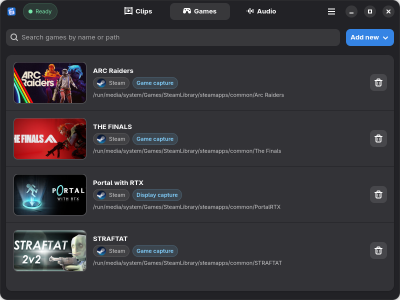
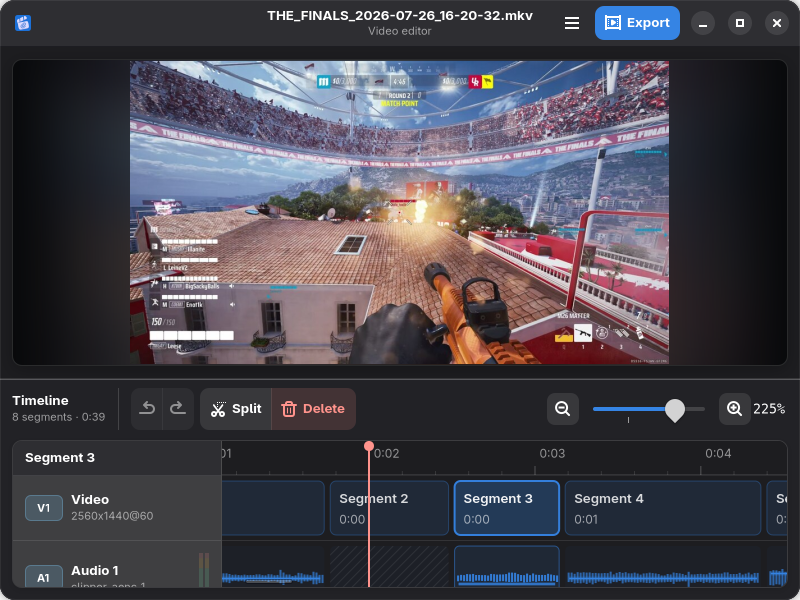
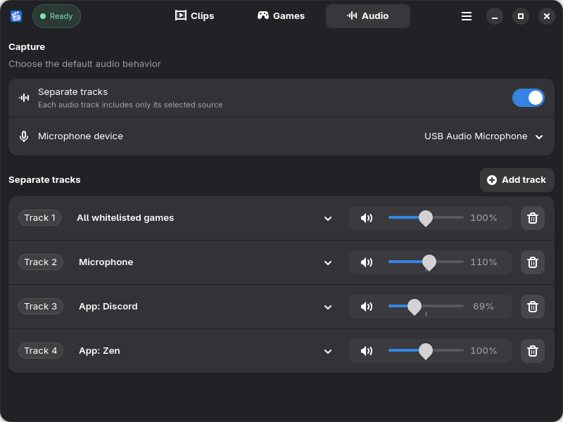
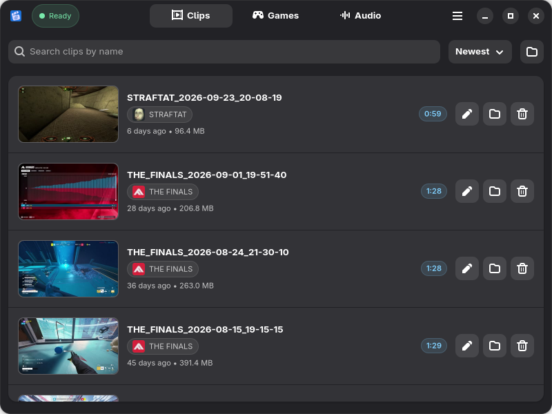

<p align="center">
  <strong>English</strong> ·
  <a href="README.uk.md">Українська</a> ·
  <a href="README.ru.md">Русский</a>
</p>

# Clipper

Clipper is a Linux app for saving clips from your recent gameplay. Add the games
you play, set a hotkey, and press it when something worth keeping happens.

If you have used NVIDIA ShadowPlay or OBS Studio's Replay Buffer, Clipper works
the same way: it keeps recent gameplay ready to save as a clip.

It is a GTK4/libadwaita app built around OBS/libobs.

## Install

### GitHub Releases

Get the latest Flatpak bundle from
[GitHub Releases](https://github.com/LeeseTheFox/Clipper/releases/latest),
then install the file you downloaded:

```bash
flatpak install --user --bundle path/to/Clipper.flatpak
```

Replace the example path with the bundle's real filename. Clipper will then
appear in your app menu.

## Features

### Per-game replays

Clipper records only while a game you've added is running. When no game is
active, recording stops automatically to save system resources.

Add games from your Steam library or select an executable. Choose display
capture or Vulkan/OpenGL game capture for each game. Press your global hotkey
or use the tray menu to save recent gameplay as a clip.

<p align="center">
  
</p>

### Trim and edit your clips

Open any saved clip in Clipper. Cut unwanted sections, mute or adjust individual
audio tracks for each segment, and undo changes. Choose the format, codecs,
resolution, and quality when exporting.

<p align="center">
  
</p>

### Separate audio tracks

Record game audio, your microphone, and apps on separate tracks, or keep them
in one mix. Adjust their volume while editing without changing the other tracks.

<p align="center">
  
</p>

### Your clips, all in one place

Clips land in one searchable library with thumbnails, game names, dates,
durations, and file sizes. Play a clip, reveal it in your file manager, open it
in the editor, or remove it without digging through folders.

<p align="center">
  
</p>

## Powered by OBS

[OBS Studio/libobs](https://obsproject.com/) handles capture,
encoding, and clip saving. Clipper adds game-aware setup, hotkeys, audio
routing, a clip library, and an editor around it.

The Flatpak bundles libobs and the capture plugins it needs. You do not need a
separate OBS Studio installation to use the released app.

## Using Clipper

On first launch, Clipper walks you through setup:

1. Choose your language on the welcome screen.
2. Set the clip length, replay buffer size, and shortcut for saving clips.
3. Choose the resolution, frame rate, file format, and video and audio codecs.
4. On Wayland, use the system display picker to select the screen to record.
5. Finish setup. You can change these settings later in Preferences.

Then add a game from your Steam library or select a running process in the
Games tab, and choose a capture method.

Launch the game and play. Press your save shortcut or use the tray menu when
something worth keeping happens. Your clip appears in the Clips tab, ready to
watch or edit. Recording stops automatically when no added game is running.

## Requirements

- Linux with Flatpak support.
- A Wayland or X11 desktop session.
- A GPU and driver compatible with your chosen capture method.

Choose a capture method for each game:

- **Display capture** records your entire selected screen while an added game
  is running, including anything else visible on that screen. It works with
  more games. On Wayland, you grant access through the system screen picker.
- **Game capture** records only the game through its Vulkan/OpenGL output.
  It requires a launch option and depends on the game's graphics API, driver,
  and whether the game allows capture hooks. Use Display capture if the game
  does not work with Game capture.

For Game capture, Clipper configures Steam launch options and asks you to
restart Steam if needed. For other launchers, copy the launch option shown
when adding the game into its launcher settings before starting it.

Clipper bundles the capture tools it needs, including 32-bit and 64-bit game
hooks. Native Steam (including SteamOS) and Flatpak Steam need no extra
packages or extensions.

## Build from source

See the [local development instructions](ui/README.md#run-it-locally) or
[Flatpak build instructions](packaging/flatpak/README.md#build-it).

## More detail

- [Engine overview](engine/README.md)
- [UI architecture](ui/README.md)
- [Flatpak packaging notes](packaging/flatpak/README.md)
- [Reproducible screenshots](tools/screenshot_fixture/README.md)

## Contributing

Found a bug or have an idea? [Open an issue](https://github.com/LeeseTheFox/Clipper/issues).
Contributions are welcome.

## Credits

The Flatpak includes OBS Studio/libobs, its capture plugins, and other
third-party components. Their notices are in [LICENSE](LICENSE).

## License

Clipper is free software under the [GNU General Public License v3.0 or
later](LICENSE) (GPL-3.0-or-later).
