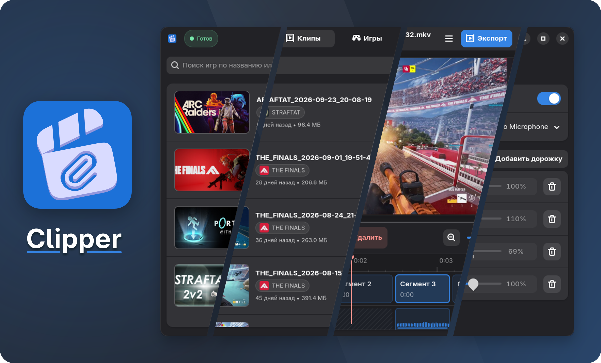
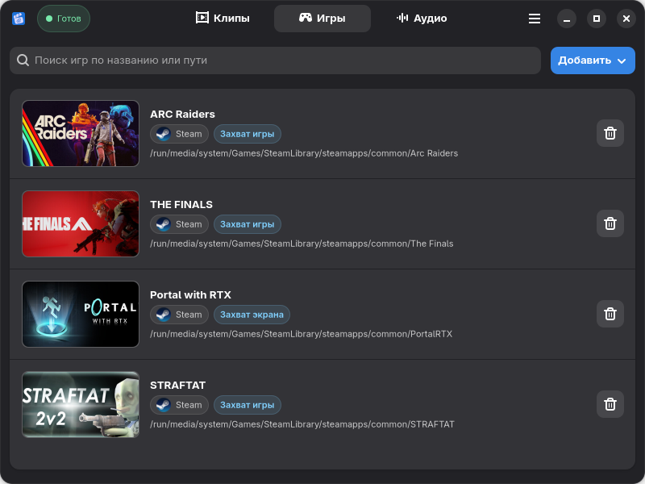
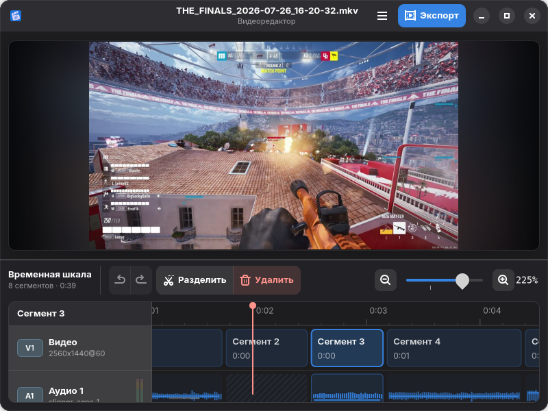
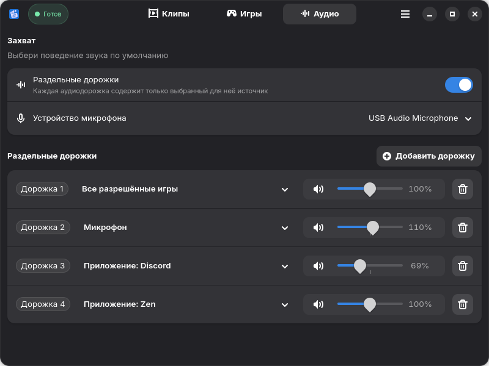
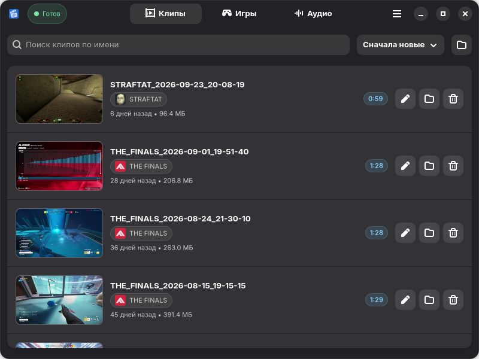

<p align="center">
  <a href="README.md">English</a> ·
  <a href="README.uk.md">Українська</a> ·
  <strong>Русский</strong>
</p>

<p align="center">
  
</p>

# Clipper

Clipper — это приложение для Linux на GTK4/libadwaita, позволяющее сохранять
клипы из недавнего игрового процесса. Добавьте игры, назначьте горячую клавишу и нажмите её, когда
произойдёт что-то стоящее.

Если вы пользовались NVIDIA ShadowPlay или Replay Buffer в OBS Studio, Clipper
работает по тому же принципу: он постоянно хранит последние моменты игры,
чтобы их можно было сохранить как клип.

<p align="center">
  <a href="https://github.com/LeeseTheFox/Clipper/releases/latest"></a>
  <a href="https://github.com/LeeseTheFox/Clipper/commits"></a>
  <a href="https://github.com/LeeseTheFox/Clipper/releases"></a>
  <a href="https://github.com/LeeseTheFox/Clipper/stargazers"></a>
</p>

## Установка

### Релизы GitHub

Скачайте последнюю версию Flatpak со страницы
[релизов GitHub](https://github.com/LeeseTheFox/Clipper/releases/latest),
затем установите загруженный файл:

```bash
flatpak install --user --bundle путь/к/Clipper.flatpak
```

Замените пример настоящим путём к загруженному файлу. После этого Clipper
появится в меню приложений.

## Возможности

### Повторы для каждой игры

Clipper записывает только тогда, когда запущена добавленная вами игра. Когда
ни одна игра не активна, запись автоматически останавливается, чтобы экономить
системные ресурсы.

Добавьте игры из библиотеки Steam или выберите исполняемый файл. Для каждой
игры выберите захват экрана или захват игры через Vulkan/OpenGL. Нажмите
глобальное сочетание клавиш или воспользуйтесь меню в трее, чтобы сохранить
последние моменты игры как клип.

<p align="center">
  
</p>

### Обрезайте и редактируйте клипы

Откройте любой сохранённый клип в Clipper. Вырезайте ненужные фрагменты,
отключайте звук или меняйте громкость отдельных аудиодорожек для каждого
фрагмента и отменяйте изменения. При экспорте выбирайте формат, кодеки,
разрешение и качество.

<p align="center">
  
</p>

### Отдельные аудиодорожки

Записывайте звук игры, микрофон и приложения на отдельные дорожки или
объедините их в один микс. Меняйте их громкость при редактировании,
не затрагивая остальные дорожки.

<p align="center">
  
</p>

### Все ваши клипы в одном месте

Клипы попадают в одну библиотеку с поиском, миниатюрами, названиями игр, датами,
длительностью и размером файлов. Воспроизводите клип, показывайте его в файловом
менеджере, редактируйте или удаляйте — не придётся искать по папкам.

<p align="center">
  
</p>

## Работает на OBS

[OBS Studio/libobs](https://obsproject.com/) отвечает за захват, кодирование
и сохранение клипов. Clipper добавляет настройки с учётом
игр, сочетания клавиш, маршрутизацию аудио, библиотеку клипов и видеоредактор.

Flatpak включает libobs и необходимые плагины захвата. Для использования
готового приложения отдельная установка OBS Studio не нужна.

## Как пользоваться Clipper

При первом запуске Clipper предложит пройти настройку:

1. Выберите язык на экране приветствия.
2. Задайте длительность клипа, размер буфера повтора и сочетание клавиш для сохранения.
3. Выберите разрешение, частоту кадров, формат файла, видео- и аудиокодеки.
4. В Wayland выберите экран для записи в системном окне выбора.
5. Завершите настройку. Позже эти параметры можно изменить в настройках приложения.

Затем добавьте игру из библиотеки Steam или выберите запущенный процесс
на вкладке «Игры» и выберите способ захвата.

Запустите игру и играйте. Когда произойдёт что-то стоящее, нажмите сочетание
клавиш для сохранения или воспользуйтесь меню в трее. Клип появится на вкладке
«Клипы», где его можно посмотреть или отредактировать. Запись автоматически
остановится, когда ни одна добавленная игра не будет запущена.

## Требования

- Linux с поддержкой Flatpak.
- Сеанс рабочего стола Wayland или X11.
- Видеокарта и драйвер, совместимые с выбранным способом захвата.

Выберите способ захвата для каждой игры:

- **Захват экрана** записывает весь выбранный экран, пока запущена добавленная
  игра, включая всё остальное, что видно на экране. Этот способ работает
  с большим числом игр. В Wayland доступ предоставляется через системное
  окно выбора экрана.
- **Захват игры** записывает только игру через её вывод Vulkan/OpenGL.
  Требует параметра запуска и зависит от графического API, драйвера и того,
  разрешает ли игра хуки захвата. Если захват игры не работает, используйте
  захват экрана.

Для захвата игры Clipper настроит параметры запуска Steam и при необходимости
предложит перезапустить Steam. Для других лаунчеров скопируйте параметр
запуска, показанный при добавлении игры, в настройки её лаунчера перед запуском.

Clipper включает необходимые инструменты захвата, в том числе 32- и 64-битные
библиотеки захвата игр. Нативному Steam (в том числе SteamOS) и Steam из Flatpak
не нужны дополнительные пакеты или расширения.

## Сборка из исходного кода

См. [инструкции для локальной разработки](ui/README.md#run-it-locally) или
[инструкции по сборке Flatpak](packaging/flatpak/README.md#build-it).

## Подробнее

- [Обзор движка](engine/README.md)
- [Архитектура UI](ui/README.md)
- [Примечания по упаковке Flatpak](packaging/flatpak/README.md)
- [Воспроизводимые скриншоты](tools/screenshot_fixture/README.md)

## Участие в разработке

Нашли ошибку или есть идея? [Сообщите об этом](https://github.com/LeeseTheFox/Clipper/issues).
Будем рады вашему участию.

## Благодарности

Flatpak включает OBS Studio/libobs, его плагины захвата и другие сторонние
компоненты. Их лицензионные уведомления находятся в файле [LICENSE](LICENSE).

## Использование генеративного ИИ

Я создал Clipper с помощью инструментов генеративного ИИ. Весь собственный
код Clipper сгенерирован ИИ. Я также использую ИИ для отладки, тестов,
документации и части переводов.

Я описываю, что хочу получить, разбираю проблемы вместе с этими инструментами
и постепенно дорабатываю результат. Так проект разрабатывался с самого начала.
Я хочу открыто об этом говорить, чтобы все, кто использует Clipper или
участвует в его разработке, знали, как он был создан.

## Лицензия

Clipper — свободное программное обеспечение, распространяемое по лицензии
[GNU General Public License версии 3 или более поздней](LICENSE)
(GPL-3.0-or-later).
