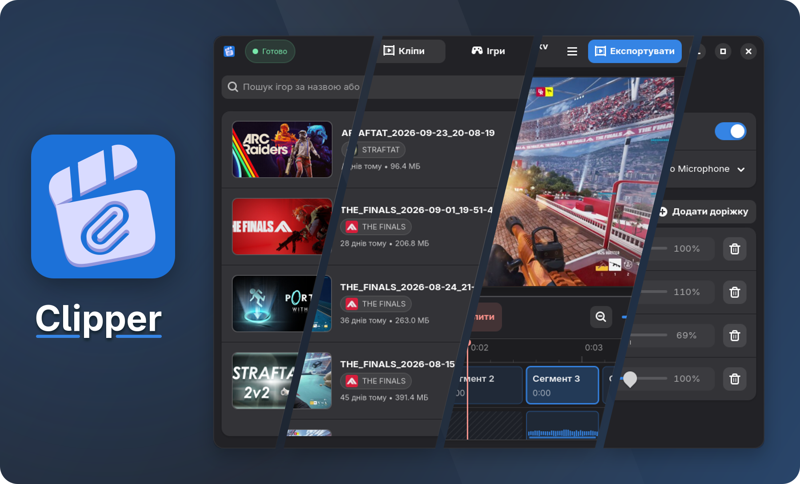
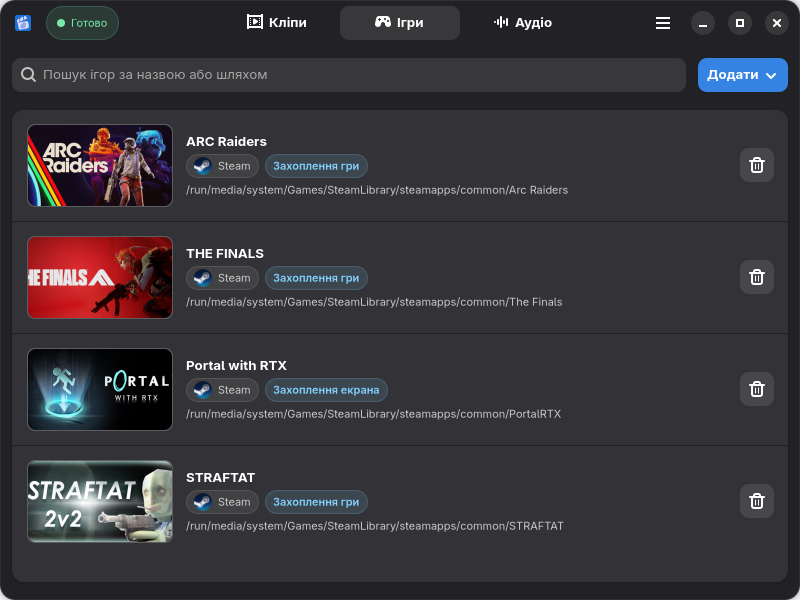
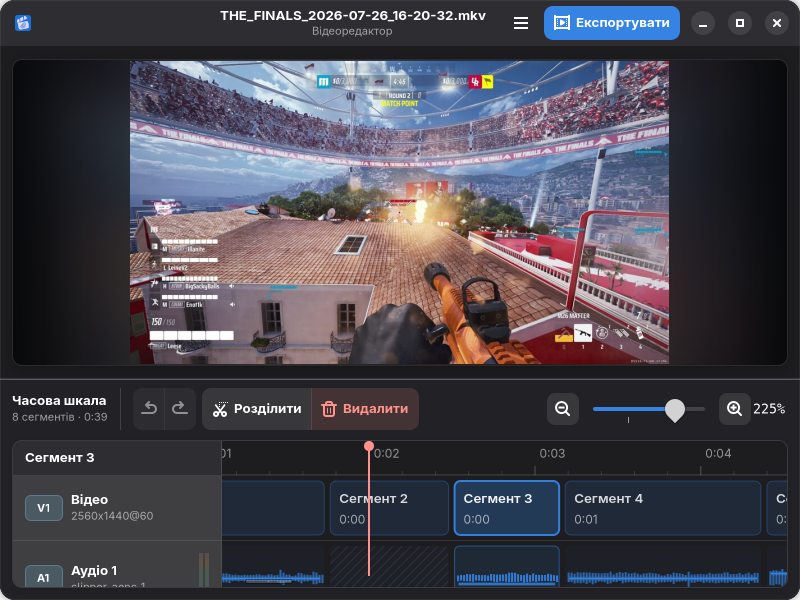
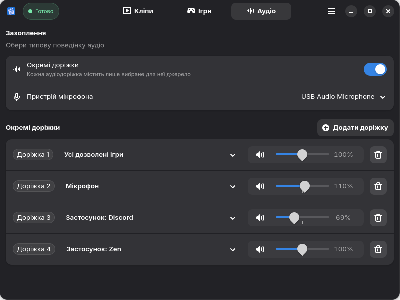
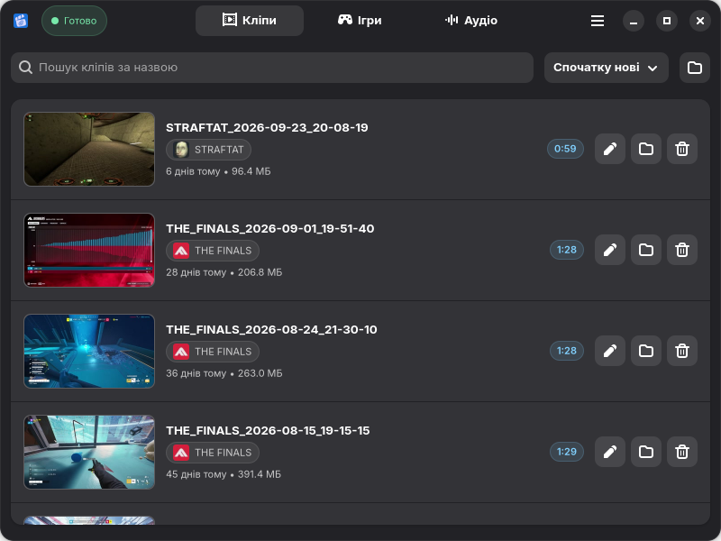

<p align="center">
  <a href="README.md">English</a> ·
  <strong>Українська</strong> ·
  <a href="README.ru.md">Русский</a>
</p>

<p align="center">
  
</p>

# Clipper

<p align="center">
  <a href="https://github.com/LeeseTheFox/Clipper/releases/latest"></a>
  <a href="https://github.com/LeeseTheFox/Clipper/commits"></a>
  <a href="https://github.com/LeeseTheFox/Clipper/releases"></a>
  <a href="https://github.com/LeeseTheFox/Clipper/stargazers"></a>
</p>

Clipper — це додаток для Linux, який дає змогу зберігати кліпи вашого геймплею.
Додайте свої ігри, налаштуйте гарячу клавішу й натисніть її, коли
станеться щось варте збереження.

Якщо ви користувалися NVIDIA ShadowPlay або Replay Buffer в OBS Studio,
Clipper працює за тим самим принципом: він тримає напоготові останній відрізок
ігрового процесу, щоб його можна було зберегти як кліп.

Це додаток на GTK4/libadwaita, з OBS/libobs у якості фундаменту.

## Встановлення

### Релізи GitHub

Завантажте найновіший пакет Flatpak зі сторінки
[релізів GitHub](https://github.com/LeeseTheFox/Clipper/releases/latest),
а потім встановіть завантажений файл:

```bash
flatpak install --user --bundle шлях/до/Clipper.flatpak
```

Замініть приклад на справжній шлях до завантаженого файла. Після цього Clipper
з’явиться в меню програм.

## Можливості

### Повтори для кожної гри

Clipper записує лише тоді, коли запущена додана вами гра. Коли жодна гра
не активна, запис автоматично зупиняється, щоб заощаджувати системні ресурси.

Додайте ігри зі своєї бібліотеки Steam або виберіть виконуваний файл. Для кожної
гри оберіть захоплення екрана або захоплення гри через Vulkan/OpenGL. Натисніть
глобальну гарячу клавішу або скористайтеся меню трея, щоб зберегти останні
моменти гри як кліп.

<p align="center">
  
</p>

### Обрізайте й редагуйте кліпи

Відкрийте будь-який збережений кліп у Clipper. Вирізайте непотрібні фрагменти,
вимикайте звук або змінюйте гучність окремих аудіодоріжок для кожного фрагмента
та скасовуйте зміни. Під час експорту обирайте формат, кодеки, роздільну
здатність і якість.

<p align="center">
  
</p>

### Окремі аудіодоріжки

Записуйте звук гри, мікрофон і застосунки на окремі доріжки або об’єднайте їх
в один мікс. Змінюйте їхню гучність під час редагування, не впливаючи на інші
доріжки.

<p align="center">
  
</p>

### Усі ваші кліпи в одному місці

Кліпи потрапляють до єдиної бібліотеки з пошуком, мініатюрами, назвами ігор,
датами, тривалістю та розміром файлів. Відтворюйте кліп, показуйте його в
менеджері файлів, редагуйте або видаляйте — без зайвих пошуків у папках.

<p align="center">
  
</p>

## Працює на OBS

[OBS Studio/libobs](https://obsproject.com/) відповідає за захоплення,
кодування та збереження кліпів. Clipper додає до нього налаштування
з урахуванням ігор, гарячі клавіші, маршрутизацію аудіо, бібліотеку кліпів і
відеоредактор.

Flatpak містить libobs і потрібні плагіни захоплення. Для використання готового
застосунку окремо встановлювати OBS Studio не потрібно.

## Як користуватися Clipper

Під час першого запуску Clipper запропонує пройти налаштування:

1. Оберіть мову на екрані привітання.
2. Задайте тривалість кліпу, розмір буфера повтору та гарячу клавішу для збереження.
3. Оберіть роздільну здатність, частоту кадрів, формат файла, відео- й аудіокодеки.
4. У Wayland оберіть екран для запису в системному вікні вибору.
5. Завершіть налаштування. Згодом ці параметри можна змінити в розділі «Параметри».

Потім додайте гру з бібліотеки Steam або виберіть запущений процес
на вкладці «Ігри» й оберіть спосіб захоплення.

Запустіть гру й грайте. Коли станеться щось варте збереження, натисніть гарячу
клавішу або скористайтеся меню трея. Кліп з’явиться на вкладці «Кліпи», де його
можна переглянути чи відредагувати. Запис автоматично зупиниться, коли жодна
додана гра не буде запущена.

## Вимоги

- Linux із підтримкою Flatpak.
- Сеанс робочого столу Wayland або X11.
- Відеокарта й драйвер, сумісні з обраним способом захоплення.

Оберіть спосіб захоплення для кожної гри:

- **Захоплення екрана** записує весь обраний екран, поки запущена додана гра,
  включно з усім іншим, що видно на екрані. Цей спосіб працює з більшою
  кількістю ігор. У Wayland доступ надається через системне вікно вибору екрана.
- **Захоплення гри** записує лише гру через її виведення Vulkan/OpenGL.
  Потребує параметра запуску й залежить від графічного API, драйвера та того,
  чи дозволяє гра хуки захоплення. Якщо захоплення гри не працює,
  використовуйте захоплення екрана.

Для захоплення гри Clipper налаштує параметри запуску Steam і за потреби
запропонує перезапустити Steam. Для інших лаунчерів скопіюйте параметр запуску,
показаний під час додавання гри, у налаштування її лаунчера перед запуском.

Clipper містить потрібні інструменти захоплення, зокрема 32- і 64-бітні
бібліотеки захоплення ігор. Нативному Steam (зокрема SteamOS) і Steam із Flatpak
не потрібні додаткові пакунки чи розширення.

## Збирання з вихідного коду

Див. [інструкції для локальної розробки](ui/README.md#run-it-locally) або
[інструкції зі збирання Flatpak](packaging/flatpak/README.md#build-it).

## Докладніше

- [Огляд рушія](engine/README.md)
- [Архітектура UI](ui/README.md)
- [Нотатки про пакування Flatpak](packaging/flatpak/README.md)
- [Відтворювані знімки екрана](tools/screenshot_fixture/README.md)

## Участь у розробці

Знайшли помилку або маєте ідею? [Повідомте про це](https://github.com/LeeseTheFox/Clipper/issues).
Долучайтеся до розробки.

## Подяки

Flatpak містить OBS Studio/libobs, його плагіни захоплення та інші сторонні
компоненти. Ліцензійні повідомлення про них наведено у файлі [LICENSE](LICENSE).

## Ліцензія

Clipper — вільне програмне забезпечення за ліцензією [GNU General Public License
версії 3 або новішої](LICENSE) (GPL-3.0-or-later).
